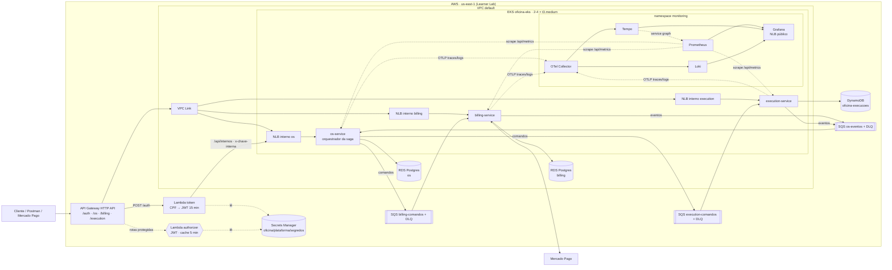

# oficina-fase4-infra

Infraestrutura da **plataforma** do Sistema Integrado de Atendimento e Execução de Serviços — Tech Challenge SOAT, Fase 4 (microsserviços).

Este repositório entrega o chão onde os três microsserviços rodam: **cluster EKS, API Gateway, as funções Lambda de autenticação (a casca), um NLB interno por serviço, os segredos compartilhados e a stack de observabilidade** (Prometheus, Grafana, Tempo, Loki e OpenTelemetry Collector). Também guarda o **ambiente local** de desenvolvimento ([`local/`](local)) e a documentação geral ([`docs/`](docs)).

Ele **não** contém código de aplicação nem os bancos e filas: cada serviço provisiona o próprio RDS/DynamoDB e a própria fila SQS no Terraform do seu repositório.

| Repositório | Papel |
| --- | --- |
| **`oficina-fase4-infra`** (este) | EKS, API Gateway, Lambdas (casca), NLBs, Secrets Manager da plataforma, observabilidade, ambiente local |
| [`oficina-os-service`](https://github.com/fdacmatheus/oficina-os-service) | OS, cadastros, estoque e **orquestrador da saga** · PostgreSQL · fila `os-eventos` |
| [`oficina-billing-service`](https://github.com/fdacmatheus/oficina-billing-service) | Orçamento, aprovação, cobrança e estorno no Mercado Pago · PostgreSQL · fila `billing-comandos` |
| [`oficina-execution-service`](https://github.com/fdacmatheus/oficina-execution-service) | Fila de execução, diagnóstico e reparo · DynamoDB · fila `execution-comandos` |
| [`oficina-fase4-lambda-auth`](https://github.com/fdacmatheus/oficina-fase4-lambda-auth) | Código das Lambdas: token por CPF e authorizer JWT |

## Tecnologias

- **Terraform** `>= 1.9` (pipeline em 1.13) com backend **S3** e lock nativo (`use_lockfile`)
- **Amazon EKS** 1.31 · node group gerenciado 2–4 × `t3.medium`
- **Amazon API Gateway** (HTTP API) com **VPC Link**, reescrita de caminho e **Lambda authorizer**
- **AWS Lambda** (Node.js 20) · **Secrets Manager** · VPC endpoint de interface
- **kube-prometheus-stack**, **Tempo**, **Loki**, **OpenTelemetry Collector** (Helm)
- **GitHub Actions** com **gitleaks**, **tflint**, plan no PR e apply na `main`

## Arquitetura



A saga orquestrada (fluxo, compensações e o porquê de orquestração) está no README do [`oficina-os-service`](https://github.com/fdacmatheus/oficina-os-service); o formato das mensagens em [`docs/CONTRATO-MENSAGENS.md`](docs/CONTRATO-MENSAGENS.md); a visão geral em [`docs/ARQUITETURA.md`](docs/ARQUITETURA.md).

## Estrutura

```
.
├── terraform/
│   ├── versions.tf          providers e backend S3 parcial
│   ├── variables.tf
│   ├── eks.tf               cluster, node group, addons, NodePort para os NLBs
│   ├── segredos.tf          Secrets Manager da plataforma e do Grafana
│   ├── kubernetes.tf        namespace e um Service LoadBalancer (NLB interno) por serviço
│   ├── lambda.tf            as duas Lambdas com pacote provisório + VPC endpoint
│   ├── apigateway.tf        HTTP API, VPC Link, authorizer, rotas e reescrita de caminho
│   ├── observabilidade.tf   kube-prometheus-stack, Tempo, Loki, OTel Collector, alertas
│   ├── outputs.tf
│   ├── dashboards/          oficina-saga.json, oficina-plataforma.json
│   └── terraform.tfvars.example
├── local/                   ambiente de desenvolvimento (docker compose)
├── docs/                    ARQUITETURA.md, CONTRATO-MENSAGENS.md
└── .github/workflows/terraform.yml
```

## Decisões de projeto

**As Lambdas são criadas aqui; o repositório da Lambda só publica o código.** Na Fase 3 o gateway lia o ARN da Lambda do state do outro repositório, e a Lambda precisava de recursos que viviam aqui — uma dependência circular que obrigava a aplicar os dois repositórios em ordem e duas vezes. Agora este repositório cria `oficina-auth-token` e `oficina-auth-authorizer` com um zip provisório (gerado por `archive_file`) e ignora mudanças de código (`lifecycle { ignore_changes = [filename, source_code_hash] }`). O pipeline da Lambda roda `aws lambda update-function-code`. O pacote provisório **falha fechado**: o token responde 503 e o authorizer nega (`isAuthorized: false`).

**Prefixo por serviço com reescrita de caminho.** Os três serviços usam o mesmo prefixo `/api` e o Swagger em `/docs`, então o gateway separa por prefixo (`/os`, `/billing`, `/execution`) e o remove antes de encaminhar: `GET /os/api/clientes` chega ao os-service como `GET /api/clientes`. A reescrita usa o *parameter mapping* do HTTP API (`"overwrite:path" = "/api/${request.path.proxy}"`, a forma com chaves que a [documentação](https://docs.aws.amazon.com/apigateway/latest/developerguide/http-api-parameter-mapping.html) pede ao combinar texto fixo e variável). Como o mapeamento é por integração, cada rota tem a sua integração; todas apontam para o listener do NLB do serviço pelo mesmo VPC Link. A query string não é alterada.

**Rotas internas inalcançáveis pelo gateway.** `/api/internos/*` do os-service existe só para a Lambda de token, que chama o NLB **por dentro da VPC**. No gateway, a rota mais específica `ANY /os/api/internos/{proxy+}` reescreve para um caminho inexistente e o os-service responde **404** — mesmo com a chave interna vazada não há caminho pela internet. O os-service continua exigindo o header `x-chave-interna` (defesa em profundidade, e protege contra acesso de dentro do cluster). Escolhemos a reescrita porque o HTTP API não tem integração MOCK e uma Lambda só para devolver 404 seria um recurso a mais sem ganho.

**Um NLB interno por serviço, com sufixo `-nlb`.** O Service `ClusterIP` de cada repositório tem o nome do serviço; o Service `LoadBalancer` daqui se chama `<servico>-nlb` para não colidir, seleciona os pods por `app: <servico>` e **não** carrega o label `app` (o ServiceMonitor seleciona por ele; com o label, cada pod seria raspado duas vezes).

**Segredos com fonte única.** `oficina/plataforma/segredos` guarda `JWT_SECRET`, `JWT_REFRESH_SECRET`, `ADMIN_PASSWORD` e `INTERNAL_API_KEY`, gerados por `random_password`. A Lambda lê em tempo de execução (`SEGREDOS_NAME`) e os pipelines dos serviços leem no deploy. Nos GitHub Secrets ficam só as credenciais de sessão da AWS. A senha do Grafana é gerada aqui e salva em `oficina/plataforma/grafana`.

**Restrições do AWS Academy Learner Lab.** Sem `iam:CreateRole`: as roles do EKS são localizadas por expressão regular (`LabEksClusterRole`, `LabEksNodeRole`) e as Lambdas usam a `LabRole`. VPC default sem NAT Gateway (~US$ 32/mês): a Lambda de token, que roda na VPC para alcançar o NLB, fala com o Secrets Manager por um **VPC endpoint**. Sem EBS CSI driver: Prometheus, Tempo e Loki usam `emptyDir`. `us-east-1e` é excluída (não suporta EKS).

**ServiceMonitor e PrometheusRule como values do Helm.** Com `kubernetes_manifest`, as CRDs precisariam existir já no `plan`, impedindo o `apply` do zero.

## Rotas do API Gateway

| Rota | Destino | Auth |
| --- | --- | --- |
| `POST /auth` | Lambda `oficina-auth-token` (CPF → JWT) | pública |
| `ANY /os/api/publico/{proxy+}` | os-service `/api/publico/...` (status da OS pelo número) | pública |
| `POST /os/api/auth/{proxy+}` | os-service `/api/auth/...` (login do admin) | pública |
| `GET /os/api/health` | os-service `/api/health` | pública |
| `ANY /os/api/internos/{proxy+}` | **bloqueada** — sempre 404 | — |
| `ANY /os/api/{proxy+}` | os-service `/api/...` | JWT |
| `ANY /billing/api/publico/{proxy+}` | billing `/api/publico/...` (link de aprovação e pagamento do cliente) | pública |
| `ANY /billing/api/webhooks/{proxy+}` | billing `/api/webhooks/...` (Mercado Pago, valida `x-signature`) | pública |
| `GET /billing/api/health` | billing `/api/health` | pública |
| `ANY /billing/api/{proxy+}` | billing `/api/...` | JWT |
| `GET /execution/api/health` | execution `/api/health` | pública |
| `ANY /execution/api/{proxy+}` | execution `/api/...` | JWT |
| `ANY /<svc>/docs`, `/<svc>/docs/{proxy+}`, `/<svc>/docs-json` | Swagger de cada serviço (`/docs...`) | pública |

O authorizer é do tipo `REQUEST` com respostas simples e cache de 300 s pelo header `Authorization`. O stage `$default` grava log de acesso em JSON no CloudWatch (`/aws/apigateway/oficina`).

## Ordem de aplicação

1. **Bucket de state** (uma vez por laboratório):
   ```bash
   CONTA=$(aws sts get-caller-identity --query Account --output text)
   aws s3api create-bucket --bucket "oficina-tfstate-$CONTA" --region us-east-1
   aws s3api put-bucket-versioning --bucket "oficina-tfstate-$CONTA" --versioning-configuration Status=Enabled
   ```
2. **Este repositório** (~20 min: control plane ~10, nodes ~3, NLBs e observabilidade ~7):
   ```bash
   cd terraform
   terraform init \
     -backend-config="bucket=oficina-tfstate-$CONTA" \
     -backend-config="key=plataforma/terraform.tfstate" \
     -backend-config="region=us-east-1" \
     -backend-config="use_lockfile=true"   # Terraform >= 1.10
   terraform apply
   ```
3. **Repositórios dos serviços**: primeiro o `infra/` de cada um (banco + fila), depois o pipeline (imagem no ECR + `kubectl apply`). A ordem entre os três é indiferente: os NLBs daqui encontram os pods por label assim que eles sobem.
4. **Repositório da Lambda**: o pipeline publica o código nas duas funções (`aws lambda update-function-code`). Até lá `POST /auth` responde 503 e as rotas protegidas negam acesso.

Pelo GitHub Actions: defina a variável de repositório `DEPLOY_ENABLED=true` e os secrets `AWS_ACCESS_KEY_ID`, `AWS_SECRET_ACCESS_KEY` e `AWS_SESSION_TOKEN` (renovados a cada sessão do laboratório).

## Acessar

```bash
terraform output api_gateway_url          # URL pública do sistema
terraform output grafana_url              # Grafana (usuário admin)
aws secretsmanager get-secret-value --secret-id oficina/plataforma/grafana \
  --query SecretString --output text | jq -r .senha
$(terraform output -raw kubeconfig_command)

GW=$(terraform output -raw api_gateway_url)
curl "$GW/os/api/health"
ADMIN=$(aws secretsmanager get-secret-value --secret-id oficina/plataforma/segredos \
  --query SecretString --output text | jq -r .ADMIN_PASSWORD)
TOKEN=$(curl -s "$GW/os/api/auth/login" -H 'content-type: application/json' \
  -d "{\"username\":\"admin\",\"password\":\"$ADMIN\"}" | jq -r .accessToken)
curl "$GW/os/api/ordens-servico" -H "Authorization: Bearer $TOKEN"
```

## Observabilidade

| Sinal | Como chega | Onde ver |
| --- | --- | --- |
| Métricas (HTTP e de negócio) | Prometheus raspa `/api/metrics` de cada serviço (ServiceMonitor por serviço; `job` = nome do serviço) | Dashboards **Oficina · Plataforma** e **Oficina · Saga distribuída** |
| Traces | Serviço → OTLP HTTP → OTel Collector → Tempo | Grafana › Explore › Tempo; mapa de serviços |
| Logs | Serviço → OTLP HTTP → OTel Collector → Loki (com `trace_id`) | Grafana › Explore › Loki; do trace para os logs e vice-versa |
| Mapa de serviços | metrics-generator do Tempo → remote write no Prometheus | Painel “Mapa de serviços” do dashboard da saga |

**Ver o trace de uma OS**: abra o dashboard **Oficina · Saga distribuída**, cole o id da OS no campo **OS (id)** e os painéis “Traces da saga” e “Logs dos 3 serviços” filtram aquela OS (o atributo `oficina.os_id` dos spans e o `correlationId` dos logs são o id da OS). Clique em um trace para ver a saga atravessando os três serviços e o SQS; de qualquer span, “Logs for this span” abre os logs no Loki. Pelo Explore: TraceQL `{ span.oficina.os_id = "<id>" }`.

### Alertas

| Alerta | Severidade | Condição |
| --- | --- | --- |
| `ServicoIndisponivel` | critical | `up == 0` em algum serviço por 2 min |
| `ServicoSemReplicas` | critical | algum serviço sem nenhum alvo saudável por 5 min |
| `PodsReiniciandoEmLoop` | warning | > 3 reinícios em 15 min |
| `LatenciaAlta` | warning | p95 > 1 s por serviço, 5 min |
| `TaxaErro5xxAlta` | critical | > 5% de 5xx por serviço, 5 min |
| `HpaNoTeto` | warning | HPA no máximo por 10 min |
| `CompensacoesEmAlta` | warning | > 5 compensações da saga em 15 min |
| `OutboxPendenteAlta` | critical | > 50 mensagens na outbox por 5 min |
| `FalhaProcessamentoOrdemServico` | critical | erro ao processar OS em 10 min |
| `FalhaIntegracao` | warning | > 5 falhas de e-mail/Mercado Pago/SQS em 15 min |
| `OrdensParadasAguardandoAprovacao` | info | > 20 OS aguardando aprovação por 30 min |

Mensagens em DLQ não viram alerta aqui: a profundidade da fila é métrica do CloudWatch e não há exporter no cluster. Consulte `ApproximateNumberOfMessagesVisible` das filas `*-dlq` no console.

### Versões dos charts

| Chart | Versão | App |
| --- | --- | --- |
| `prometheus-community/kube-prometheus-stack` | 92.10.1 | operator v0.94.1 |
| `grafana/tempo` | 1.24.3 | Tempo 2.9.0 (chart monolítico; o 1.24.4 marca o chart como *deprecated* em favor do `grafana-community/tempo` 3.x) |
| `grafana/loki` | 6.55.0 | Loki 3.6.7 (single binary, filesystem) |
| `open-telemetry/opentelemetry-collector` | 0.175.1 | Collector 0.161.0 (imagem contrib) |

## Ambiente local

O mesmo desenho, em containers: Floci (SQS, DynamoDB e Secrets Manager emulados), um Postgres por serviço, MailHog e a observabilidade completa.

```bash
cd local
docker compose up -d               # projeto "oficina-local"
# suba os 3 serviços (pnpm start:dev ou o docker compose de cada repositório)
ADMIN_PASSWORD=<o do .env do os-service> ./demo-saga.sh            # caminho feliz
ADMIN_PASSWORD=... ./demo-saga.sh pagamento | execucao | recusa    # compensações
```

| Serviço | Endereço |
| --- | --- |
| Grafana (sem login) | http://localhost:3000 |
| Prometheus | http://localhost:9090 |
| Floci / UI | http://localhost:4566 / http://localhost:4500 |
| MailHog | http://localhost:8025 |
| OTLP (gRPC / HTTP) | `localhost:4317` / `localhost:4318` |

## Custo estimado (Learner Lab, us-east-1, on-demand)

| Recurso | US$/hora |
| --- | --- |
| EKS control plane | 0,100 |
| 2 nodes `t3.medium` (até 4 com escala: 0,166) | 0,083 |
| 4 NLBs (3 internos + Grafana) | 0,090 |
| 2 RDS `db.t3.micro` (os e billing) + 40 GB gp2 | 0,040 |
| VPC endpoint do Secrets Manager (2 AZs) | 0,020 |
| IPv4 públicos (nodes, NLB do Grafana) | ~0,035 |
| Discos dos nodes, logs no CloudWatch, Secrets Manager | ~0,015 |
| API Gateway, Lambda, SQS, DynamoDB on-demand, VPC Link do HTTP API | ~0 no volume da demo |
| **Total** | **~0,38/h ≈ US$ 9 por dia** |

Com o crédito de US$ 50 isso dá cerca de **5 dias ligados**. **Rode `terraform destroy` assim que terminar as demos** (primeiro o `infra/` dos serviços, depois este repositório) — ou o workflow com `destroy: true`. Encerrar a sessão do laboratório não basta: control plane, NLBs e VPC endpoint continuam cobrando.

## Variáveis

| Variável | Padrão | Descrição |
| --- | --- | --- |
| `region` | `us-east-1` | Única região liberada no Learner Lab |
| `project` | `oficina` | Prefixo dos recursos |
| `cluster_version` | `1.31` | Versão do Kubernetes |
| `node_instance_type` | `t3.medium` | Tipo dos nodes |
| `node_desired_size` / `min` / `max` | `2` / `2` / `4` | Escala do node group |
| `namespace` | `oficina` | Namespace dos serviços |
| `eks_cluster_role_regex` / `eks_node_role_regex` | `.*LabEksClusterRole.*` / `.*LabEksNodeRole.*` | Roles pré-criadas |
| `lab_role_name` | `LabRole` | Role das Lambdas |
| `lambda_runtime` | `nodejs20.x` | Runtime das Lambdas |
| `log_retention_days` | `7` | Retenção dos logs |

## Outputs

| Output | Consumido por |
| --- | --- |
| `api_gateway_url` | Postman, vídeo, `PUBLIC_BASE_URL` do billing (`<url>/billing`) |
| `grafana_url` | Demonstração |
| `nlb_dns` | Diagnóstico; `OS_SERVICE_URL` da Lambda de token (já configurado) |
| `otel_exporter_otlp_endpoint` | `OTEL_EXPORTER_OTLP_ENDPOINT` nos ConfigMaps dos serviços |
| `segredos_secret_name`, `grafana_secret_name` | Pipelines dos serviços, operador |
| `lambda_token_name`, `lambda_authorizer_name` | Pipeline da Lambda (`update-function-code`) |
| `cluster_name`, `namespace` | Pipelines dos serviços |

## CI/CD

[`.github/workflows/terraform.yml`](.github/workflows/terraform.yml)

| Gatilho | Ação |
| --- | --- |
| Pull Request | gitleaks + `fmt` + `validate` + tflint + JSON/YAML; `plan` comentado no PR se `DEPLOY_ENABLED` |
| Push em `main` | Validação + `apply` se `DEPLOY_ENABLED` |
| `workflow_dispatch` com `destroy` | Destrói a plataforma |

O backend é parcial: o bucket `oficina-tfstate-<conta>` é montado no `init` a partir da conta da sessão, porque o ID muda a cada laboratório.
