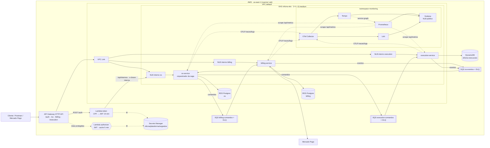
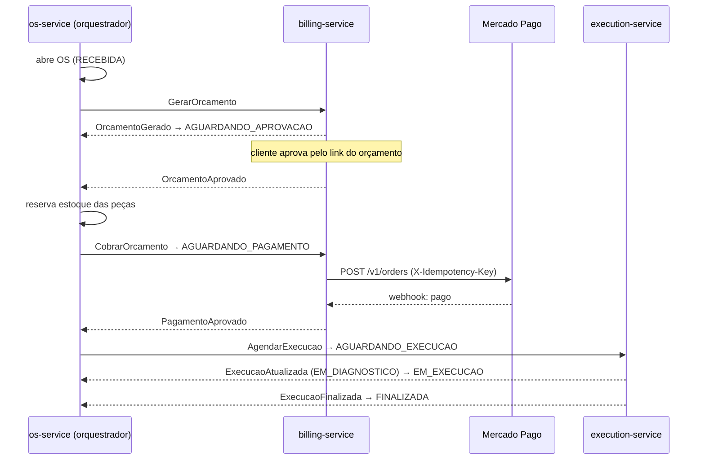

# Fase 4 · Arquitetura de microsserviços

Visão geral da plataforma. O detalhe de cada serviço está no README do próprio repositório; a saga orquestrada (fluxo, compensações e a escolha por orquestração) está descrita em detalhe no README do [`oficina-os-service`](https://github.com/fdacmatheus/oficina-os-service).

## Serviços

| Repositório | Responsabilidade | Banco | Fila de entrada (SQS) |
|---|---|---|---|
| `oficina-os-service` | Clientes, veículos, catálogo (serviços, peças, estoque), ordem de serviço e histórico. **Orquestrador da saga.** | PostgreSQL | `os-eventos` |
| `oficina-billing-service` | Orçamento, aprovação do cliente, cobrança e estorno no Mercado Pago (API de Orders), webhook | PostgreSQL (instância própria) | `billing-comandos` |
| `oficina-execution-service` | Fila de execução, diagnóstico e reparo, linha do tempo da execução | DynamoDB | `execution-comandos` |

Plataforma (evolução dos repositórios da Fase 3):

| Repositório | Responsabilidade |
|---|---|
| `oficina-fase4-infra` | EKS, API Gateway, as duas Lambdas (casca), NLB interno por serviço, Secrets Manager da plataforma, observabilidade (Prometheus, Grafana, Tempo, Loki, OTel Collector) e o ambiente local |
| `oficina-fase4-lambda-auth` | Código das Lambdas: emissão de token por CPF e authorizer JWT |

## Visão geral

- **Entrada única**: os NLBs são internos; só o API Gateway (via VPC Link) e a Lambda de token (dentro da VPC) os alcançam.
- **Banco por serviço**: nenhum serviço lê o banco de outro; a conversa é por SQS (saga) ou REST.
- **Segredos**: `oficina/plataforma/segredos` é a fonte única de `JWT_SECRET`, `JWT_REFRESH_SECRET`, `ADMIN_PASSWORD` e `INTERNAL_API_KEY`; cada serviço guarda as credenciais do próprio banco em `oficina/<servico>/database`.
- **Observabilidade**: métricas (Prometheus), traces (Tempo) e logs (Loki) correlacionados por `trace_id` e por `correlationId` = id da OS.

Cada serviço tem seu próprio Terraform para o banco e a fila de entrada. Nenhum serviço lê o banco de outro: a conversa é por mensagem (SQS) ou REST.

## Saga orquestrada

Resumo abaixo; a descrição completa (inclusive o porquê de orquestração e não coreografia) está no README do `oficina-os-service`.

O `os-service` guarda o estado da saga junto com a OS, na mesma transação. Ele manda **comandos** para a fila de cada serviço e recebe **eventos** na sua fila.

### Compensações

| Falha | Compensação | Estado final |
|---|---|---|
| Cliente recusa o orçamento | — | CANCELADA |
| Estoque insuficiente ao reservar | `CancelarOrcamento` no billing | CANCELADA |
| Pagamento recusado ou expirado | libera estoque | CANCELADA |
| Execução falha | `EstornarPagamento` (refund no MP) + libera estoque | CANCELADA |

### Garantias

- **Outbox transacional** nos serviços com Postgres: a mudança de estado e a mensagem a publicar são gravadas na mesma transação; um publicador envia para o SQS depois. Nada se perde se o processo cair entre o commit e o envio.
- **Consumidores idempotentes**: cada mensagem tem `messageId`; o consumidor registra os já processados e ignora repetidos (o SQS entrega *at least once*).
- **Idempotência no Mercado Pago**: `X-Idempotency-Key` = `<osId>:<etapa>`.
- **Rastreio**: `correlationId` = id da OS, propagado em toda mensagem e em todo log JSON.

## Ambiente local

Floci (emulador de AWS: SQS, DynamoDB, Secrets Manager) + Postgres em container. Os segredos ficam em `.env` local, fora do git; os repositórios são públicos e só trazem `.env.example` com valores falsos. `gitleaks` roda no CI.

## Qualidade

Cobertura mínima de **95%** (linhas, branches, funções e statements) em cada serviço, travada no `coverageThreshold` do Jest — o CI falha abaixo disso. O requisito da fase é 80%.
